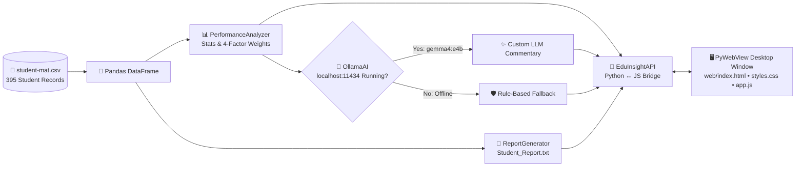

<div align="center">

<!-- Top Tech-Blue & Dark-Slate Animated Wave Banner -->


<!-- Animated Typing SVG -->
<a href="#">
  
</a>

<br/>

<!-- Tech Stack & Portfolio Badges -->
<p>
  
  
  
  
  
</p>

<!-- Quick Navigation -->
<p>
  <a href="#overview">Overview</a> •
  <a href="#contributions">My Role (UI &amp; AI)</a> •
  <a href="#features">Features &amp; Model</a> •
  <a href="#architecture">Architecture</a> •
  <a href="#showcase">UI Showcase</a> •
  <a href="#structure">Project Structure</a> •
  <a href="#quickstart">Quick Start</a> •
  <a href="#team">Team</a>
</p>

</div>

---

<a name="overview"></a>
## 📌 Overview

**EduInsight** is a desktop student-performance analytics application powered by **Python, Pandas, PyWebView, and local Ollama LLM**. Built on the **UCI Student Performance Dataset** (`student-mat.csv`, 395 records), the software was upgraded from a legacy CLI/CustomTkinter utility into a sleek, responsive native desktop interface featuring interactive visual analytics, multi-criteria student search, automated report generation, and AI-generated academic feedback.

### 📊 Dataset Snapshot (`student-mat.csv`)

| Cohort Metric | Value | Breakdown |
| :--- | :---: | :--- |
| **Total Students** | `395` | `187` Male · `208` Female \| `307` Urban · `88` Rural |
| **Final Grade (`G3`)** | `10.42 / 20` | Mean `10.42` · Highest `20` · Lowest `0` |
| **Pass / Fail (`G3 ≥ 10`)** | `67.09%` Pass | `265` Passed (`67.09%`) · `130` Failed (`32.91%`) |
| **Scholarship Eligible (`G3 ≥ 18`)** | `18` Students | Top `4.56%` high-achieving cohort |

---

<a name="contributions"></a>
## 🌟 My Role — UI/UX Optimization & AI Custom Feedback

In this 2-developer project, my teammate engineered the core statistical algorithms, OOP student classes, and report generator, while **I designed and built the modern desktop UI layer and the AI custom commentary engine**:

<table align="center" width="100%">
  <tr>
    <td width="50%" valign="top">
      <h3 align="center">🎨 Desktop UI/UX Redesign (<code>gui.py</code> &amp; <code>web/</code>)</h3>
      <ul>
        <li><b>PyWebView Desktop Migration:</b> Replaced the legacy CustomTkinter interface with a native <code>1440×900</code> (min <code>1120×680</code>) PyWebView window running a custom <b>HTML5 / CSS3 / JS</b> interface with zero external web server overhead.</li>
        <li><b>Python–JS Bridge (<code>EduInsightAPI</code>):</b> Built a clean JSON-serializable API exposing cohort KPIs, student profiles, grade filters, and report downloads directly to the frontend.</li>
        <li><b>Cohesive Design System:</b> Crafted a clean, modern palette (Primary <code>#4285F4</code>, Hover <code>#1A73E8</code>, Sidebar <code>#202124</code>, Canvas <code>#F8F9FA</code>, Cards <code>#FFFFFF</code>).</li>
      </ul>
    </td>
    <td width="50%" valign="top">
      <h3 align="center">🤖 AI Custom Feedback Engine (<code>ai_comment.py</code>)</h3>
      <ul>
        <li><b>Local Ollama LLM Integration:</b> Connected <code>OllamaAI</code> to local inference (<code>localhost:11434</code>, default model <code>gemma4:e4b</code>) to generate personalized student performance reviews.</li>
        <li><b>Structured Prompt Engineering:</b> Dynamically injects each student's grade, failures, study hours, absences, health score, and weighted factor breakdown into a structured prompt returning <i>Performance Level</i>, <i>Comment</i>, and <i>Recommendation</i>.</li>
        <li><b>Graceful Rule-Based Fallback:</b> Automatically detects if Ollama is offline via <code>/api/tags</code> and falls back seamlessly to deterministic rule-based commentary.</li>
      </ul>
    </td>
  </tr>
</table>

---

<a name="features"></a>
## ✨ Key Features & Factor Weighting Model

### 🚀 Application Capabilities
- **📊 Cohort Analytics Dashboard:** Displays summary KPIs, grade distribution charts, gender ratios, study-time vs. average grade trends, and pass/fail statistics.
- **🔍 Multi-Mode Student Search:** Look up any student by **ID (1–395)**, filter cohorts by exact **Final Grade (0–20)**, or list all **Scholarship-Eligible (`G3 ≥ 18`)** students.
- **🤖 AI-Driven Student Commentary:** Generates custom academic feedback and actionable recommendations per student via Ollama LLM or built-in rule analysis.
- **🏆 Top 10 Leaderboard:** Ranks the highest-performing students across schools (`GP` and `MS`).
- **📄 One-Click Report Export:** Generates, previews, and downloads the formatted 5-section `Student_Report.txt` summary.
- **💻 Dual-Mode Compatibility:** Supports both the modern **PyWebView Desktop GUI (`gui.py`)** and the retained **Legacy CLI (`main.py`)**.

### ⚖️ 4-Factor Performance Weighting (`PerformanceAnalyzer`)

| Factor | Weight | Impact Scale | Evaluation Criteria |
| :--- | :---: | :--- | :--- |
| **Previous Failures** | `38%` | `████████░░` | Primary academic risk predictor; flags need for extra support |
| **Weekly Study Time** | `27%` | `██████░░░░` | 4-tier scale (`1`: `<2h`, `2`: `2–5h`, `3`: `5–10h`, `4`: `>10h`) |
| **Absences** | `22%` | `█████░░░░░` | Evaluates class attendance consistency and disengagement risk |
| **Health Status** | `13%` | `███░░░░░░░` | 5-point self-reported scale (`1`: Very Poor to `5`: Excellent) |

---

<a name="architecture"></a>
## 🏗️ System Architecture



---

<a name="showcase"></a>
## 📸 UI Showcase

> *Add screenshots of your PyWebView desktop application into `docs/screenshots/` to showcase the dashboard, charts, and AI student commentary panel.*

<table align="center" width="100%">
  <tr>
    <td width="50%" align="center">
      <b>📊 Analytics Dashboard &amp; Cohort KPIs</b><br/>
      
    </td>
    <td width="50%" align="center">
      <b>🔍 Student Lookup &amp; AI Custom Commentary</b><br/>
      
    </td>
  </tr>
  <tr>
    <td width="50%" align="center">
      <b>🏆 Top 10 Leaderboard &amp; Grade Filter</b><br/>
      
    </td>
    <td width="50%" align="center">
      <b>📄 Automated Report Preview &amp; Export</b><br/>
      
    </td>
  </tr>
</table>

---

<a name="structure"></a>
## 📂 Project Structure

```text
EduInsight/
├── gui.py                 # PyWebView desktop entry point & EduInsightAPI JS bridge
├── web/
│   ├── index.html         # Desktop UI shell & navigation layout
│   ├── styles.css         # Design tokens (#4285F4 / #202124) & responsive card styles
│   └── app.js             # Client-side views, interactive charts & API calls
├── ai_comment.py          # OllamaAI (gemma4:e4b) custom feedback & rule-based fallback
├── analyzer.py            # PerformanceAnalyzer: cohort metrics & 4-factor breakdown
├── student.py             # Student base class & ExcellentStudent subclass (OOP)
├── report.py              # ReportGenerator: exports formatted Student_Report.txt
├── visualization.py       # Matplotlib chart helpers (retained for legacy CLI)
├── main.py                # Legacy terminal interface (retained for compatibility)
├── student-mat.csv        # UCI student mathematics performance dataset (395 rows)
├── Student_Report.txt     # Generated analytics summary output
└── requirements.txt       # Python dependencies (pandas, requests, pywebview)
```

---

<a name="quickstart"></a>
## 🚀 Quick Start

### 1. Clone & Install Dependencies

```bash
git clone https://github.com/yeowzongzheng0215-droid/EduInsight.git
cd EduInsight
pip install -r requirements.txt
```

> **Linux Note:** PyWebView requires a native GUI backend such as GTK (`PyGObject` + GTK3) or Qt.

### 2. Optional — Enable Local AI Feedback (Ollama)

Install [Ollama](https://ollama.ai/), start the local server, and pull the configured model:

```bash
ollama serve
ollama pull gemma4:e4b
```

*(If Ollama is not running, EduInsight automatically uses its built-in rule-based analysis with zero interruption.)*

### 3. Launch the Application

**Modern PyWebView Desktop App (Recommended):**
```bash
python gui.py
```

**Legacy Console Mode:**
```bash
python main.py
```

---

<a name="team"></a>
## 👥 Team & Collaboration

<table align="center" width="100%">
  <tr>
    <td width="50%" valign="top">
      <h3 align="center">🎨 YEOW ZONG ZHENG</h3>
      <p align="center">
        <b>UI/UX Optimization &amp; AI Integration</b><br/>
        <a href="[https://github.com/yeowzongzheng0215-droid](https://github.com/yeowzongzheng0215-droid)">@yeowzongzheng0215-droid</a>
      </p>
      <ul>
        <li><b>Desktop UI Redesign:</b> Migrated the app to PyWebView with a modern HTML/CSS/JS interface and cohesive visual design system.</li>
        <li><b>Python–JS Bridge:</b> Engineered <code>EduInsightAPI</code> in <code>gui.py</code> for seamless data exchange and report downloads.</li>
        <li><b>AI Custom Commentary:</b> Built <code>OllamaAI</code> (<code>gemma4:e4b</code>) prompt generation and automatic fallback logic in <code>ai_comment.py</code>.</li>
      </ul>
    </td>
    <td width="50%" valign="top">
      <h3 align="center">⚙️ Project Teammate</h3>
      <p align="center">
        <b>Core Data Analytics &amp; OOP Backend</b><br/>
        <i>Collaborator</i>
      </p>
      <ul>
        <li><b>OOP Domain Modeling:</b> Designed <code>Student</code> and <code>ExcellentStudent</code> inheritance classes in <code>student.py</code>.</li>
        <li><b>Statistical Engine:</b> Built <code>PerformanceAnalyzer</code> cohort aggregations and 4-factor scoring in <code>analyzer.py</code>.</li>
        <li><b>CLI &amp; Report Generator:</b> Implemented <code>main.py</code> console menus and <code>Student_Report.txt</code> export in <code>report.py</code>.</li>
      </ul>
    </td>
  </tr>
</table>

---

<div align="center">

<!-- Bottom Tech-Blue & Dark-Slate Wave Footer -->


</div>
