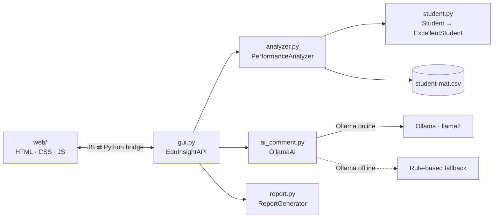

<div align="center">

# 🎓 EduInsight

### Student Performance Analytics System

**A modern desktop analytics suite that turns student performance data into visual insights and AI-driven academic feedback.**

<br>

[](https://www.python.org/)
[](https://pywebview.flowrl.com/)
[](https://pandas.pydata.org/)
[](https://ollama.ai/)
[](#)
[](#-team--responsibilities)

<sub>*Introduction to Python — Final Group Project*</sub>

<br>

[Overview](#-project-overview) •
[My Contributions](#-highlighted-contributions-my-role) •
[Features](#-key-features) •
[Architecture](#-project-architecture) •
[Getting Started](#-getting-started) •
[Team](#-team--responsibilities)

</div>

---

## 📌 Project Overview

**EduInsight** is a student performance analytics desktop application built on the **UCI Student Performance Dataset** (`student-mat.csv`, 395 records).

The project started as a terminal / CustomTkinter utility. It has since been upgraded into a clean, native desktop interface powered by **PyWebView + HTML/CSS/JavaScript**, paired with a local **Ollama LLM** integration that produces personalized commentary for each student.

| Metric | Dataset Snapshot (`student-mat.csv`) |
| :--- | :--- |
| **Total Students** | `395` (187 Male · 208 Female \| 307 Urban · 88 Rural) |
| **Average Final Grade (`G3`)** | `10.42 / 20` (Range: `0` – `20`) |
| **Pass Rate (`G3 ≥ 10`)** | `67.09%` (`265` Passed · `130` Failed) |
| **Scholarship Eligible (`G3 ≥ 18`)** | `18` Excellent Students |

---

## 📸 Preview

<div align="center">

| Analytics Dashboard | Student Lookup & AI Comment |
| :---: | :---: |
|  |  |

| Top 10 Leaderboard | Report Preview |
| :---: | :---: |
|  |  |

</div>

---

## 🌟 Highlighted Contributions (My Role)

As part of a 2-person team, my primary focus was elevating the **user experience** and the **intelligence layer** of the application.

### 1. Modern Desktop UI Optimization &nbsp;`gui.py` · `web/`

- Rebuilt the legacy interface into a responsive, minimalist desktop app (`1440×900`, minimum `1120×680`) using **PyWebView**, with zero web-server overhead.
- Engineered a clean, JSON-serializable **Python-to-JavaScript bridge** (`EduInsightAPI`) that connects the backend Pandas analytics directly to interactive frontend views.
- Established a cohesive **Material-inspired design system** for clear hierarchy, readability, and effortless navigation.

### 2. AI Custom Feedback Engine &nbsp;`ai_comment.py`

- Integrated local LLM inference via **Ollama** (`llama2`) to generate tailored, context-aware academic feedback from each student's profile and weighted performance factors.
- Built a **graceful fallback mechanism**: if Ollama is offline or unavailable, the system seamlessly switches to deterministic rule-based commentary, so student lookup never breaks.

---

## ✨ Key Features

| Module | Capabilities |
| :--- | :--- |
| **📊 Analytics Dashboard** | Cohort KPIs, final grade distribution, gender breakdown, study-time vs. grade trends, and pass/fail overview. |
| **🔍 Smart Student Lookup** | Search by **Student ID (1–395)**, filter by **Final Grade (0–20)**, or list all **Scholarship-Eligible (`G3 ≥ 18`)** students. |
| **⚖️ 4-Factor Breakdown** | Evaluates every student across four weighted academic indicators, with tailored recommendations. |
| **🤖 AI Custom Commentary** | Individualized performance comments from a local Ollama LLM, backed by reliable built-in fallback logic. |
| **🏆 Top 10 Leaderboard** | Ranks and displays the highest-performing students across schools (`GP` / `MS`). |
| **📄 Automated Reporting** | Generates, previews, and exports a structured 5-section text summary (`Student_Report.txt`). |
| **💻 Dual Interface Support** | Run the modern **PyWebView Desktop App** (`gui.py`) or the retained **Legacy CLI Mode** (`main.py`). |

---

## ⚖️ Performance Factor Weighting Model

When inspecting an individual student, `PerformanceAnalyzer` evaluates four core predictors. These feed into both the UI breakdown and the AI prompt.

| Factor | Weight | Visual Weight (1 block ≈ 5%) | Evaluation Criteria |
| :--- | :---: | :--- | :--- |
| **Previous Failures** | `38%` | `████████░░░░░░░░░░░░` | Strongest risk predictor; flags the need for targeted academic support |
| **Weekly Study Time** | `27%` | `█████░░░░░░░░░░░░░░░` | 4-tier scale (`<2h`, `2–5h`, `5–10h`, `>10h`) |
| **Absences** | `22%` | `████░░░░░░░░░░░░░░░░` | Tracks attendance consistency and disengagement risk |
| **Health Status** | `13%` | `███░░░░░░░░░░░░░░░░░` | 5-point self-reported scale (`Very Poor` to `Excellent`) |

---

## 🎨 UI Design System

| Role | Token | Preview |
| :--- | :---: | :---: |
| **Primary Accent** | `#4285F4` |  |
| **Hover / Active** | `#1A73E8` |  |
| **Sidebar Surface** | `#202124` |  |
| **Canvas Background** | `#F8F9FA` |  |
| **Card Surface** | `#FFFFFF` |  |

---

## 🗂️ Project Architecture

EduInsight is designed around clean **Object-Oriented Programming (OOP)** principles, including class inheritance and polymorphism (`Student` → `ExcellentStudent`).

### System Overview



### Directory Structure

```text
EduInsight/
├── gui.py                 # PyWebView desktop entry point & EduInsightAPI JS bridge
├── web/
│   ├── index.html         # Application layout shell
│   ├── styles.css         # Custom UI design system & responsive styling
│   └── app.js             # Client-side routing, interactive views & charts
├── analyzer.py            # PerformanceAnalyzer: cohort stats & 4-factor breakdown
├── ai_comment.py          # OllamaAI: local LLM custom feedback + rule-based fallback
├── student.py             # Student base class & ExcellentStudent subclass (OOP)
├── report.py              # ReportGenerator: exports formatted Student_Report.txt
├── visualization.py       # Matplotlib chart helpers (used by legacy CLI)
├── main.py                # Legacy terminal menu interface (retained for compatibility)
├── student-mat.csv        # UCI student mathematics performance dataset (395 rows)
├── Student_Report.txt     # Generated analytics summary output
└── requirements.txt       # Python package dependencies
```

---

## 🧰 Tech Stack

| Layer | Technology |
| :--- | :--- |
| **Language** | Python 3.10+ |
| **Desktop Shell** | PyWebView |
| **Frontend** | HTML · CSS · JavaScript |
| **Data Processing** | Pandas |
| **AI / LLM** | Ollama (`llama2`), running locally |
| **Charts (Legacy CLI)** | Matplotlib |
| **Dataset** | UCI Student Performance Dataset (mathematics) |

### 💡 Skills Demonstrated

- **Object-oriented design** — inheritance and polymorphism in a real analytics workflow
- **Data analysis with Pandas** — cohort statistics, filtering, and weighted factor scoring
- **Python ↔ JavaScript integration** — a JSON-serializable bridge between backend logic and a web-based UI
- **Local LLM integration** — prompt construction from structured student data using Ollama
- **Resilient system design** — graceful degradation with a deterministic fallback when the AI service is unavailable
- **UI/UX design** — a cohesive, minimalist design system with responsive layout

---

## 🚀 Getting Started

### 1. Clone & Install Dependencies

```bash
git clone https://github.com/<your-username>/<repo-name>.git
cd <repo-name>
pip install -r requirements.txt
```

> **🐧 Linux Note:** PyWebView requires a native GUI backend such as GTK (`PyGObject` + GTK3) or Qt.
>
> **📈 CLI Visualization Note:** To run the legacy terminal charts (`main.py`), make sure `matplotlib` is also installed: `pip install matplotlib`.

### 2. Optional — Enable Local AI Feedback (Ollama)

Install [Ollama](https://ollama.ai/), start the local server, and pull the model:

```bash
ollama serve
ollama pull llama2
```

> If Ollama is not running, EduInsight automatically falls back to built-in analytical commentary.

### 3. Launch the Application

**Desktop App (recommended — PyWebView UI):**

```bash
python gui.py
```

**Legacy CLI Mode:**

```bash
python main.py
```

---

## 👥 Team & Responsibilities

| Member | Primary Responsibilities |
| :--- | :--- |
| **[Your Name]** | **UI/UX Optimization & AI Integration** — PyWebView desktop migration, HTML/CSS/JS interface & design system, Python-JS bridge (`gui.py`), Ollama custom AI feedback & fallback handling (`ai_comment.py`) |
| **[Teammate's Name]** | **Core Analytics & OOP Architecture** — dataset processing, `Student` / `ExcellentStudent` classes, `PerformanceAnalyzer` statistics, CLI workflow (`main.py`), and `ReportGenerator` |

---

<div align="center">

<sub>Built with Python, Pandas, PyWebView, and Ollama · UCI Student Performance Dataset</sub>

</div>
